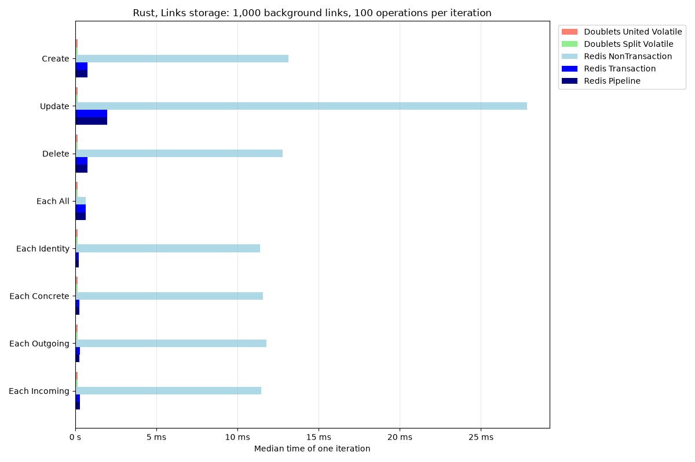
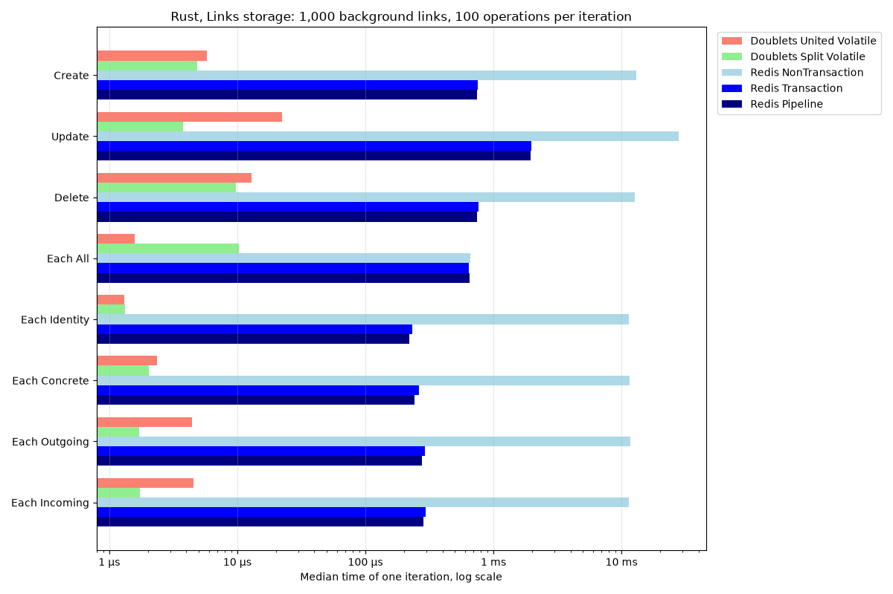
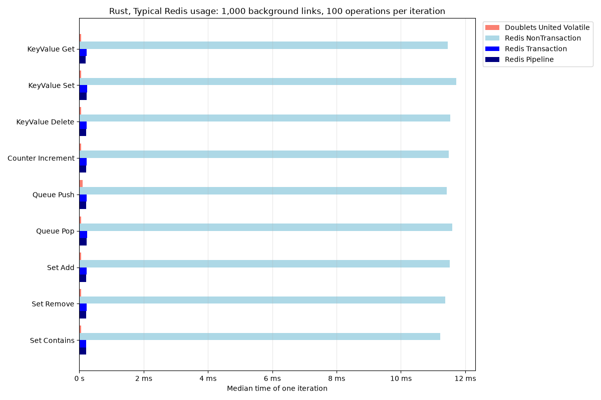
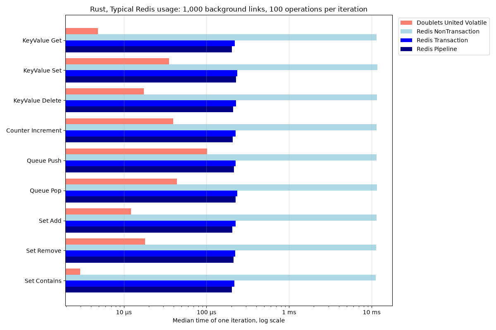
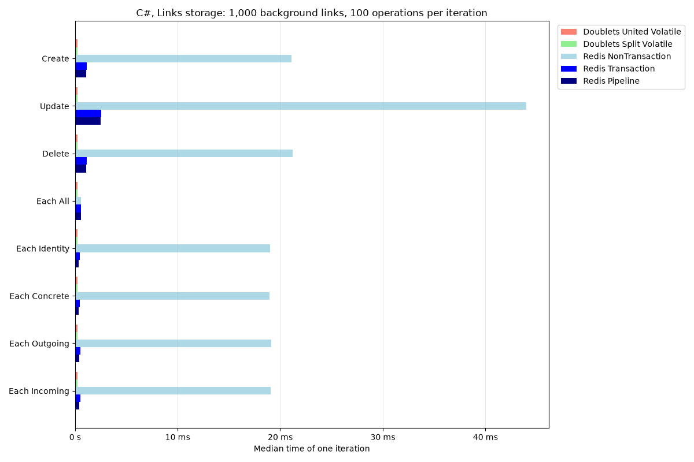
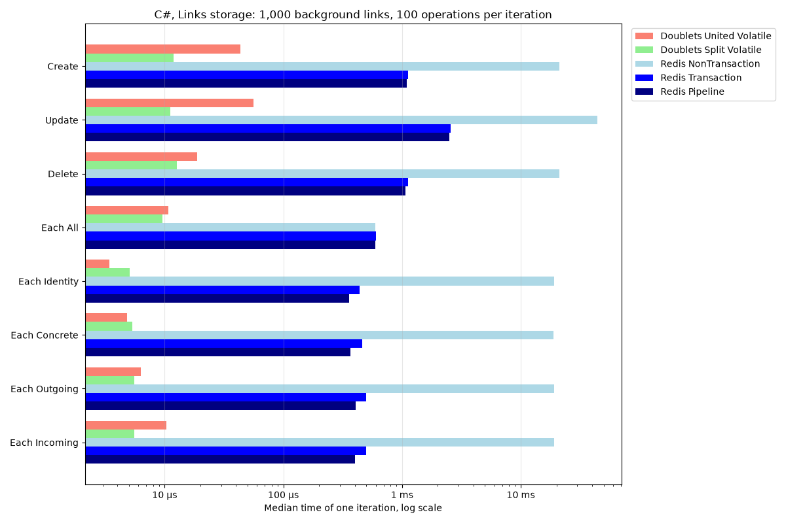
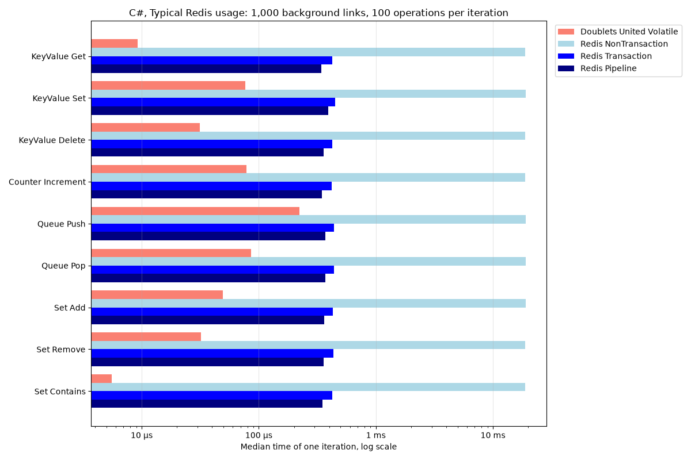

# Comparisons.RedisVSDoublets ([русская версия](README.ru.md))

[](https://github.com/linksplatform/Comparisons.RedisVSDoublets/actions/workflows/rust.yml)
[](https://github.com/linksplatform/Comparisons.RedisVSDoublets/actions/workflows/csharp.yml)
[](https://github.com/linksplatform/Comparisons.RedisVSDoublets/actions/workflows/benchmarks.yml)
[](https://github.com/linksplatform/Comparisons.RedisVSDoublets/actions/workflows/quality.yml)

Comparison of [Redis](https://redis.io) and LinksPlatform's Doublets (links)
as in-memory storage, in Rust and in C#, made like
[Comparisons.SQLiteVSDoublets](https://github.com/linksplatform/Comparisons.SQLiteVSDoublets)
for [issue #1](https://github.com/linksplatform/Comparisons.RedisVSDoublets/issues/1).
Doublets runs in memory, without files, in the benchmark process; Redis runs as
a local server without persistence. Both are used through native libraries,
without an intermediate layer:

| Language | Redis client | Doublets |
| --- | --- | --- |
| Rust | [redis-rs](https://crates.io/crates/redis) (synchronous) | [doublets](https://crates.io/crates/doublets) 0.8.0 |
| C# | [StackExchange.Redis](https://www.nuget.org/packages/StackExchange.Redis) | [Platform.Data.Doublets](https://www.nuget.org/packages/Platform.Data.Doublets) 0.18.1 |

## Benchmarks

There are two suites, and both languages run the same work on the same data.
`B` is the number of background links (or keys, queue items and set members)
that the store holds before every iteration, and `N` is the number of
operations of one iteration.

### Links storage

Both databases store links `(id, source, target)` behind the same interface
(the `Doublets` trait of doublets in Rust, `IBenchedLinks` in C#), and every
store starts with the point links `1..=B`:

| Operation | Measured work of one iteration | Undone after the iteration by |
| --- | --- | --- |
| Create | `N` point links `B + 1..=B + N` | deleting them |
| Update | `N` × (`update(id, 0, 0)`, then `update(id, id, id)`) | nothing (the second update restores the link) |
| Delete | the links `B` down to `B - N + 1` | creating them again |
| Each All | one enumeration of all `B` links | nothing (read only) |
| Each Identity | `N` queries `[id, *, *]` for the ids `1..=N` | nothing (read only) |
| Each Concrete | `N` queries `[*, id, id]` | nothing (read only) |
| Each Outgoing | `N` queries `[*, id, *]` | nothing (read only) |
| Each Incoming | `N` queries `[*, *, id]` | nothing (read only) |

Redis keeps a link in one hash and indexes it by three more keys, so every
query is one native read command, and every change is one call of a Redis
function of [`redis/links.lua`](redis/links.lua), shared by both languages,
which updates the link and all its indexes atomically in one round trip:

| Key | Type | Content | Query |
| --- | --- | --- | --- |
| `links` | hash | id → `source:target` | `[id, *, *]` = `HGET`, `[*, *, *]` = `HGETALL` |
| `out:{source}` | hash | id → target | `[*, source, *]` = `HGETALL` |
| `in:{target}` | hash | id → source | `[*, *, target]` = `HGETALL` |
| `pair:{source}:{target}` | set | ids | `[*, source, target]` = `SMEMBERS` |

Doublets runs both of its in-memory stores: `Doublets_United_Volatile` (one
array of links with index trees) and `Doublets_Split_Volatile` (separate data
and index arrays).

### Typical Redis usage

The data structures that Redis is typically used for, reimplemented in links.
The store starts with the keys `1..=B` (each with its own number as the value),
the queue `1, ..., B` and the set `{1, ..., B}`:

| Operation | Measured work of one iteration | Undone after the iteration by |
| --- | --- | --- |
| KeyValue Get | `N` × `GET k` for the keys `1..=N` | nothing (read only) |
| KeyValue Set | `N` × `SET k k+B` for the keys `1..=N` | `SET k k` |
| KeyValue Delete | `N` × `DEL k` for the keys `B` down to `B - N + 1` | `SET k k` |
| Counter Increment | `N` × `INCR k` for the keys `1..=N` | `SET k k` |
| Queue Push | `N` × `RPUSH B+i` | `N` × `RPOP` |
| Queue Pop | `N` × `LPOP`, which returns `1..=N` | `LPUSH` of `N` down to `1` |
| Set Add | `N` × `SADD B+i` | `SREM B+i` |
| Set Remove | `N` × `SREM m` for the members `B` down to `B - N + 1` | `SADD m` |
| Set Contains | `N` × `SISMEMBER m` for the members `1..=N` | nothing (read only) |

Redis keeps them in its native types, so every operation is one native
command: the strings `k:{key}`, the list `queue` and the set `members`.
Doublets stores numbers as external references (raw numbers), which never
collide with link ids, and keeps:

- a key-value pair as the link `(key, value)`, so `GET key` is the index
  search `(*, key, *)`;
- a set member as the link `(set, member)`, where `set` is a point link, so
  `SISMEMBER` is the search of the pair `(set, member)`;
- the queue as a singly linked list: the node of a value is the link
  `(next, value)`, and the head link `queue = (first, last)` points to its
  ends, so `RPUSH` and `LPOP` follow link ids only.

Only the united store is used here: the split stores of both libraries lose
links that mix link ids and raw numbers (see [experiments](experiments)).
Keys, values and members are numbers from 1 to `i64::MAX`, the largest value
of a Redis counter; the Doublets stores reject other numbers.

### Redis modes

Every Redis benchmark runs in three modes, so the cost of the round trips is
visible:

| Implementation | A finished iteration |
| --- | --- |
| `Redis_NonTransaction` | every operation is one round trip, and its result is known when it returns |
| `Redis_Transaction` | the operations of the iteration are queued in `MULTI`/`EXEC` |
| `Redis_Pipeline` | the operations of the iteration are pipelined |

The measured time starts before the iteration begins and ends after it is
committed, so in the transaction and pipeline modes it includes sending the
queued commands and receiving all replies. Every found link and read value is
consumed (`black_box` in Rust, a checksum in C#).

### Method

- Before the measurement the store gets its background data, and after every
  iteration the undo puts it back into the same state, so every iteration
  starts from the same data. Neither the background data nor the undo is
  measured, and neither is the connection.
- Every benchmark checks its results outside the measured time: the store must
  hold exactly the background data before the first and after the last
  iteration, and one iteration before the measurement must find exactly the
  expected links or values (their number and the sum of their ids or values).
  A store that loses data or finds wrong results fails the run instead of
  reporting a time.
- Rust uses [Criterion](https://crates.io/crates/criterion); C# uses a harness
  with the same sampling, which prints the same `bencher` lines. Redis takes 10
  flat samples after 1 s of warm-up in 5 s; Doublets takes 100 samples after
  1 s of warm-up in 2 s. The tables show the median time of one iteration.
- Every Doublets cell compares its median with the fastest Redis mode (in
  bold): `× faster`, `× slower`, or `≈ same` if the medians differ by less than
  5% or their ±1 standard deviation ranges overlap.
- Every language, backend and size runs in its own GitHub Actions job (its own
  virtual machine), so they do not compete for the same CPU, and Redis runs in
  that job as a service container with its snapshots switched off. Pull
  requests check the whole pipeline with `B = 1,000` and `N = 100`; pushes to
  `main` measure `B = 10,000`, `100,000` and `1,000,000` with `N = 1,000` and
  update the results below. The workflow can also be started manually with
  other sizes.
- The provenance line of every table records the Redis, client, Doublets and
  compiler or SDK versions, the CPU, the commit, the date and the run.

### Limitations

- Redis time includes the client serialization and a local network round
  trip, while Doublets works in the benchmark process; this is the difference
  between the two access paths that the comparison measures. Remote networks,
  concurrent clients, memory usage and persistence are not measured.
- The benchmarks use a single standalone Redis server: the functions compute
  their keys from the link, so they do not run in a Redis Cluster.
- The benchmarks and the tests empty the Redis database of `REDIS_URL`
  (`FLUSHDB`), so it must be a disposable database.
- The stores of doublets 0.5.0 to 0.8.0 (Rust) fail after 1,040,384 links, because they
  take the part of the memory that `platform-mem` returns after growing it; the
  benchmarks wrap the memory in [`memory::Whole`](rust/src/memory.rs), which
  returns the whole memory, and
  [`experiments/check-full-size.sh`](experiments/check-full-size.sh) checks
  the largest scheduled size.

## Running locally

Start a disposable Redis server without persistence, then run both suites of
both languages and generate the tables and charts:

```sh
docker run -d --rm --name redis-comparison -p 127.0.0.1:6379:6379 \
  redis:8.10.2 redis-server --save '' --appendonly no
export REDIS_URL=redis://localhost:6379
python3 -m pip install -r scripts/requirements.txt
examples/run-comparison.sh 1000
```

The sizes are set with `BENCHMARK_BACKGROUND_LINKS` (`B`, default 1,000) and
`BENCHMARK_LINKS` (`N`, default 100), and `BENCHMARK_BACKEND=redis` or
`doublets` runs one backend only:

```sh
(cd rust && BENCHMARK_BACKEND=doublets cargo bench --bench bench)
BENCHMARK_BACKEND=redis dotnet run -c Release --project csharp/RedisVSDoublets
```

Tests check that every store gives the same results as a model of the
operations, including Redis in every mode, and that every undo restores the
background data; see [CONTRIBUTING.md](CONTRIBUTING.md) for all
local checks.

## Results

The [Benchmarks workflow](.github/workflows/benchmarks.yml) generates the
content between the markers below on every push to `main`. `main` is
protected, so the workflow needs a `BENCHMARK_PUSH_TOKEN` secret (or
permission for `github-actions` to push) to publish it; until then the results
are in the `Benchmark report` artifact of the run.
The raw results of the check run of the pull request that added the comparison
(`B = 1,000`, `N = 100`) are in [`docs/sample-results`](docs/sample-results).

<!-- results:start -->
<!-- markdownlint-disable MD013 MD020 MD024 -->

### Rust

#### Rust: 1,000 background links, 100 operations per iteration

_Median time of one iteration with 100 operations. Redis 8.10.2 through redis-rs 1.8.0; doublets 0.5.0. CPU AMD EPYC 7763 64-Core Processor, runtime rustc 1.98.1 (48a229cea 2026-09-01), commit 6ef0747, [GitHub Actions run](https://github.com/linksplatform/Comparisons.RedisVSDoublets/actions/runs/40029663341) on 2026-10-23._

Links storage:

| Operation | Doublets United Volatile | Doublets Split Volatile | Redis NonTransaction | Redis Transaction | Redis Pipeline |
| --- | ---: | ---: | ---: | ---: | ---: |
| Create | 5.82 µs (128× faster) | 4.85 µs (153× faster) | 13.1 ms | 757 µs | **745 µs** |
| Update | 22.3 µs (87.9× faster) | 3.76 µs (522× faster) | 27.8 ms | 1.97 ms | **1.96 ms** |
| Delete | 12.9 µs (57.9× faster) | 9.71 µs (77× faster) | 12.8 ms | 764 µs | **747 µs** |
| Each All | 1.59 µs (405× faster) | 10.4 µs (62.1× faster) | 657 µs | **644 µs** | 655 µs |
| Each Identity | 1.31 µs (167× faster) | 1.34 µs (164× faster) | 11.4 ms | 231 µs | **219 µs** |
| Each Concrete | 2.37 µs (103× faster) | 2.03 µs (120× faster) | 11.6 ms | 261 µs | **243 µs** |
| Each Outgoing | 4.4 µs (62.6× faster) | 1.71 µs (161× faster) | 11.8 ms | 291 µs | **276 µs** |
| Each Incoming | 4.53 µs (62.4× faster) | 1.74 µs (162× faster) | 11.5 ms | 295 µs | **283 µs** |




Typical Redis usage:

| Operation | Doublets United Volatile | Redis NonTransaction | Redis Transaction | Redis Pipeline |
| --- | ---: | ---: | ---: | ---: |
| KeyValue Get | 4.86 µs (41.8× faster) | 11.5 ms | 220 µs | **203 µs** |
| KeyValue Set | 35.4 µs (6.47× faster) | 11.7 ms | 237 µs | **229 µs** |
| KeyValue Delete | 17.5 µs (12.1× faster) | 11.5 ms | 227 µs | **211 µs** |
| Counter Increment | 39.7 µs (5.26× faster) | 11.5 ms | 226 µs | **209 µs** |
| Queue Push | 101 µs (2.13× faster) | 11.4 ms | 226 µs | **216 µs** |
| Queue Pop | 44.2 µs (5.09× faster) | 11.6 ms | 237 µs | **225 µs** |
| Set Add | 12.2 µs (16.8× faster) | 11.5 ms | 225 µs | **206 µs** |
| Set Remove | 18 µs (11.8× faster) | 11.4 ms | 224 µs | **212 µs** |
| Set Contains | 2.98 µs (68.6× faster) | 11.2 ms | 218 µs | **204 µs** |




### C#

#### C#: 1,000 background links, 100 operations per iteration

_Median time of one iteration with 100 operations. Redis 8.10.2 through StackExchange.Redis 3.4.20; Platform.Data.Doublets 0.18.1. CPU AMD EPYC 7763 64-Core Processor (Redis) and AMD EPYC 9V74 80-Core Processor (Doublets), runtime .NET SDK 10.0.402, commit 6ef0747, [GitHub Actions run](https://github.com/linksplatform/Comparisons.RedisVSDoublets/actions/runs/40029663341) on 2026-10-23._

Links storage:

| Operation | Doublets United Volatile | Doublets Split Volatile | Redis NonTransaction | Redis Transaction | Redis Pipeline |
| --- | ---: | ---: | ---: | ---: | ---: |
| Create | 43.6 µs (25.1× faster) | 11.9 µs (91.8× faster) | 21.1 ms | 1.12 ms | **1.1 ms** |
| Update | 56.3 µs (44.2× faster) | 11.1 µs (224× faster) | 44 ms | 2.58 ms | **2.49 ms** |
| Delete | 18.9 µs (56.6× faster) | 12.7 µs (84.3× faster) | 21.2 ms | 1.12 ms | **1.07 ms** |
| Each All | 10.8 µs (55.1× faster) | 9.58 µs (62× faster) | 599 µs | 601 µs | **594 µs** |
| Each Identity | 3.42 µs (105× faster) | 5.05 µs (71× faster) | 19 ms | 440 µs | **359 µs** |
| Each Concrete | 4.82 µs (76.4× faster) | 5.31 µs (69.3× faster) | 18.9 ms | 463 µs | **368 µs** |
| Each Outgoing | 6.32 µs (64.1× faster) | 5.57 µs (72.8× faster) | 19.1 ms | 500 µs | **405 µs** |
| Each Incoming | 10.4 µs (38.8× faster) | 5.58 µs (72.2× faster) | 19.1 ms | 499 µs | **403 µs** |




Typical Redis usage:

| Operation | Doublets United Volatile | Redis NonTransaction | Redis Transaction | Redis Pipeline |
| --- | ---: | ---: | ---: | ---: |
| KeyValue Get | 9.24 µs (37.1× faster) | 18.9 ms | 423 µs | **343 µs** |
| KeyValue Set | 76.8 µs (5.11× faster) | 19 ms | 450 µs | **393 µs** |
| KeyValue Delete | 31.3 µs (11.4× faster) | 19 ms | 426 µs | **357 µs** |
| Counter Increment | 78.9 µs (4.4× faster) | 18.9 ms | 418 µs | **348 µs** |
| Queue Push | 222 µs (1.67× faster) | 19 ms | 439 µs | **372 µs** |
| Queue Pop | 85.6 µs (4.34× faster) | 19 ms | 440 µs | **372 µs** |
| Set Add | 49.6 µs (7.34× faster) | 19 ms | 431 µs | **364 µs** |
| Set Remove | 32.2 µs (11.2× faster) | 18.9 ms | 432 µs | **360 µs** |
| Set Contains | 5.57 µs (62.7× faster) | 18.8 ms | 426 µs | **350 µs** |




<!-- markdownlint-restore -->
<!-- results:end -->
